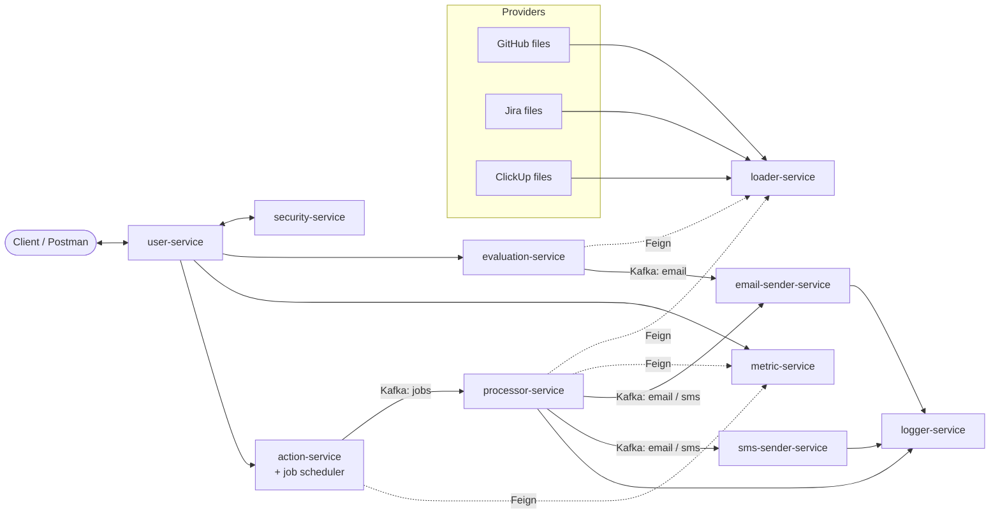

# Alert Hub

Alert Hub notifies project managers about changes in their task-management tools (**GitHub, Jira, ClickUp**). Managers define **metrics** (e.g. "10 `bug` tasks in the last 12 hours") and **actions** (when the metric condition is met, send an **SMS** or **Email**). A scheduler checks actions every 30 minutes and the system sends the notifications through Kafka.

> Team project for the **MST × Hasoub Labs** Microservices & DevOps course.

---

## Architecture



Solid arrows = REST or Kafka · dotted arrows = OpenFeign calls.

---

## Services

| # | Service | Responsibility | Database | Owner |
|---|---------|----------------|----------|-------|
| 1 | `loader-service` | Reads the latest provider file (hourly + manual trigger), maps it to one schema, saves to `platformInformation` | PostgreSQL `loader_db` | _TBD_ |
| 2 | `security-service` | Users, roles and permissions (`user`, `role`, `user_role`) | PostgreSQL `security_db` | _TBD_ |
| 3 | `user-service` | Entry point for clients; checks permissions and routes requests | PostgreSQL `user_db` | _TBD_ |
| 4 | `metric-service` | CRUD for metrics (label, threshold, time frame) | PostgreSQL `metric_db` | _TBD_ |
| 5 | `action-service` | CRUD for actions + **job scheduler** (every 30 min, pushes due actions to Kafka) | PostgreSQL `action_db` | _TBD_ |
| 6 | `processor-service` | Consumes jobs, evaluates the metric conditions, produces `email` / `sms` messages | — | _TBD_ |
| 7 | `evaluation-service` | Developer insights (most-label, label aggregate, task amount), result sent by email | — | _TBD_ |
| 8 | `email-sender-service` | Consumes `email` topic and sends emails | — | _TBD_ |
| 9 | `sms-sender-service` | Consumes `sms` topic and sends SMS | — | _TBD_ |
| 10 | `logger-service` | Stores logs from processor / senders | MongoDB (`logs`) | _TBD_ |

Every service (except logger) must have: **service-layer tests**, **exception handling**, and **Swagger docs**.

---

## Tech stack

**Java 25 (Eclipse Temurin)** · **Spring Boot 4.1.2** · Spring Data JPA · PostgreSQL · MongoDB · Apache Kafka (KRaft) · OpenFeign · springdoc-openapi 3.x (Swagger) · Lombok · SLF4J · JUnit/Mockito · Docker · Minikube (Kubernetes)

> All services use **the same Java and Spring Boot versions**. Upgrade them together in one PR.

### Creating a new service (start.spring.io / IntelliJ)

- Maven · Java · Jar · Properties · **Java 25** · **Spring Boot 4.1.2**
- Group `com.mst.alerthub` · Artifact `<name>-service` · Package `com.mst.alerthub.<name>` (no dashes)
- Base dependencies: Spring Web, Lombok, Validation, DevTools, Actuator, Spring for Apache Kafka (logs go to Kafka)
- Plus, if needed: Spring Data JPA + PostgreSQL Driver · Spring Data MongoDB (logger) · OpenFeign
- After generating: add `springdoc-openapi-starter-webmvc-ui` (3.x) to `pom.xml`, add the module to the root `pom.xml`, copy `.github/workflows/loader-service.yml`

---

## Repository structure

```
alert-hub/
├── services/            # one independent Spring Boot project per microservice
├── data/                # provider files: github/  jira/  clickup/
├── infra/
│   └── k8s/             # Minikube manifests (PostgreSQL, MongoDB, Kafka, services)
├── .github/
│   ├── workflows/       # one CI workflow per service (path-filtered)
│   ├── CODEOWNERS
│   └── pull_request_template.md
├── pom.xml              # root aggregator: lists the services, nothing inherits from it
└── README.md
```

**Rule:** services never import each other's code. They talk only over REST (Feign) or Kafka. Each service has its own `pom.xml`, `Dockerfile` and database.

---

## Getting started

**Prerequisites:** JDK 25 (Eclipse Temurin), Docker Desktop, Minikube, kubectl, Git, IntelliJ IDEA. Maven is not needed: each service ships the Maven wrapper (`./mvnw`).

```bash
git clone https://github.com/MST-Alerthub-Team/alert-hub.git
cd alert-hub
```

In IntelliJ: **File → Open → the `alert-hub` folder**. The root `pom.xml` loads all services.

### Local infrastructure

PostgreSQL, MongoDB and Kafka run in **Minikube**. The team writes the manifests in `infra/k8s/` (in progress). To reach them from IntelliJ, forward the ports:

```bash
minikube start
kubectl apply -f infra/k8s/
kubectl port-forward svc/postgres 5432:5432
kubectl port-forward svc/kafka 9092:9092
kubectl port-forward svc/mongodb 27017:27017
```

Then run a service:

```bash
cd services/loader-service
./mvnw spring-boot:run
```

Passwords come from environment variables (e.g. `DB_PASSWORD`), never from committed files.

### Ports (proposal)

| Service | Port | Service | Port |
|---|---|---|---|
| user-service | 8081 | processor-service | 8086 |
| security-service | 8082 | evaluation-service | 8087 |
| loader-service | 8083 | email-sender-service | 8088 |
| metric-service | 8084 | sms-sender-service | 8089 |
| action-service | 8085 | logger-service | 8090 |

### Kafka topics (proposal)

| Topic | Producer | Consumer | Content |
|---|---|---|---|
| `jobs` | action-service | processor-service | Due action to check |
| `email` | processor, evaluation | email-sender-service | Recipient email + message |
| `sms` | processor-service | sms-sender-service | Recipient phone + message |
| `logs` | all services | logger-service | `timestamp`, `serviceName`, `logLevel`, `message` |

### Logging

- Every service logs with **SLF4J** (`@Slf4j` from Lombok).
- Profiles control the level: `dev` → `DEBUG` for `com.mst.alerthub`, `prod` → `INFO`.
- Events are also published to the `logs` topic and stored by logger-service in MongoDB (`INFO` and above by default).

---

## Provider data files

Files live in `data/<provider>/` and follow `{provider}_yyyy_MM_ddTHH_mm_ss`, e.g. `jira_2024_08_22T13_30_00`. The loader always reads the latest file it hasn't scanned yet. Empty numeric values are treated as `0`.

---

## How we work

- **Branches:** `feature/<service>-<short-name>`, `fix/<service>-<short-name>`, `chore/<short-name>` (e.g. `feature/loader-hourly-scan`)
- **Commits:** `<type>(<service>): <message>`, e.g. `feat(loader): map jira fields to schema`
- **Pull requests:** no direct pushes to `main`; 1 approval + green CI required; squash merge only
- **Tasks:** tracked on the GitHub Project board, one issue per feature
- **Secrets:** never commit passwords or real personal data; use environment variables and fake seed data

---

## Deployment (Part Two)

Each service gets a `Dockerfile` → image pushed to Docker Hub → deployed to **Minikube** with manifests in `infra/k8s/` (`Deployment` + `Service`, `Ingress` if needed).

---

## Team

| Name | GitHub | Services |
|---|---|---|
| Abdalla Mahamid | [@abedkhma](https://github.com/abedkhma) | _TBD_ |
| Mohammed Ibrahim | [@Mohammedib24](https://github.com/Mohammedib24) | _TBD_ |
| Hilal Sharkawi | _TBD_ | _TBD_ |
| Tasneem Mhameed | [@Tasneem-Mhameed](https://github.com/Tasneem-Mhameed) | _TBD_ |